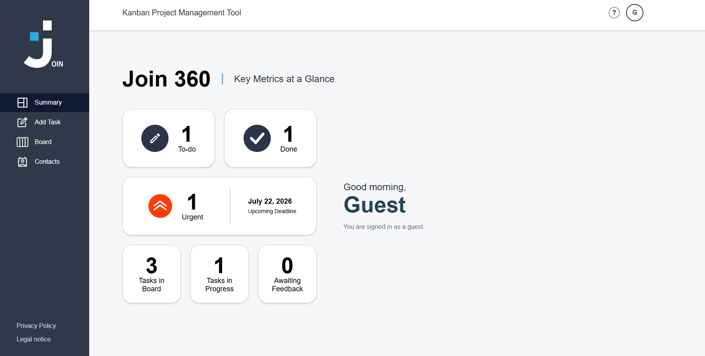
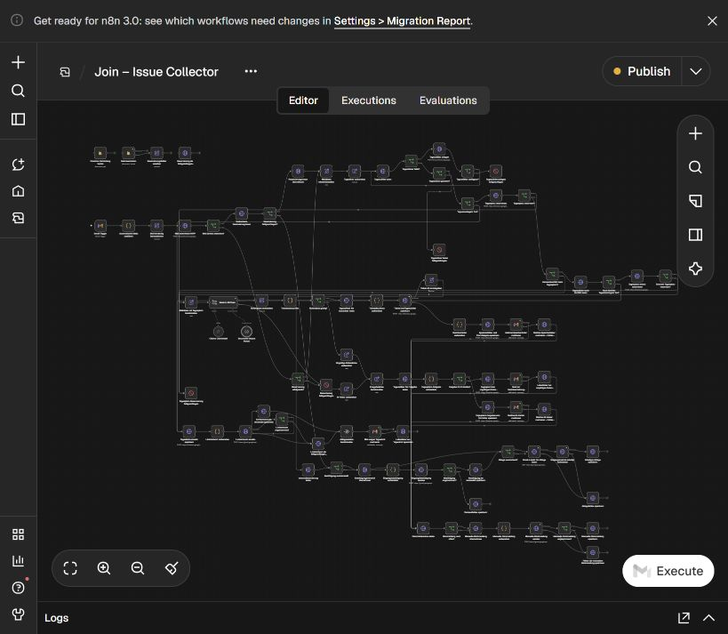
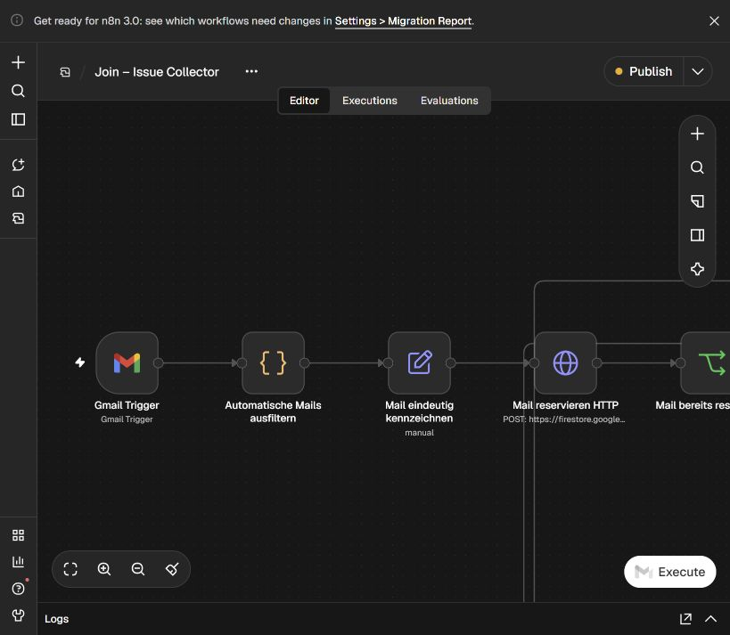
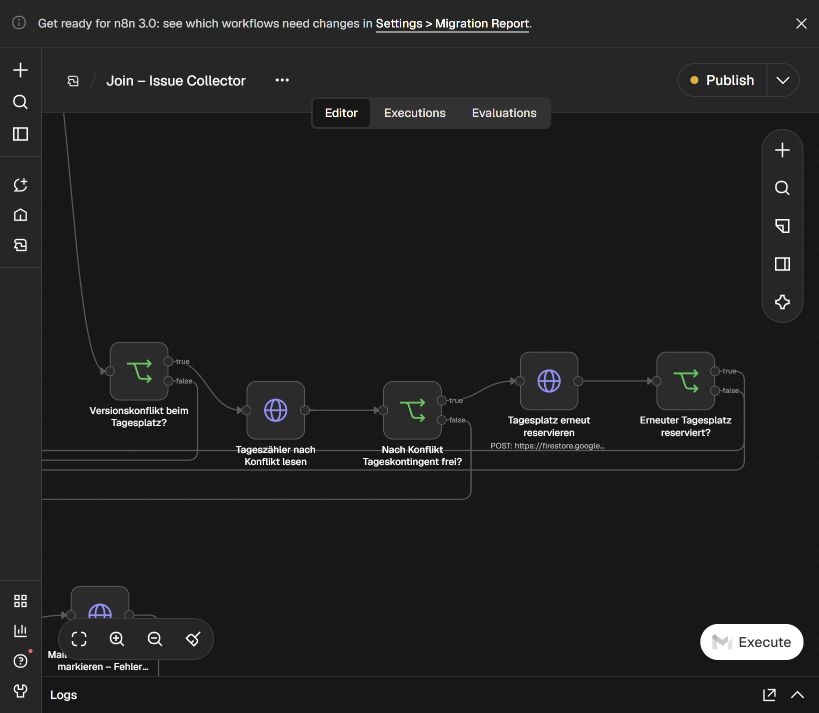
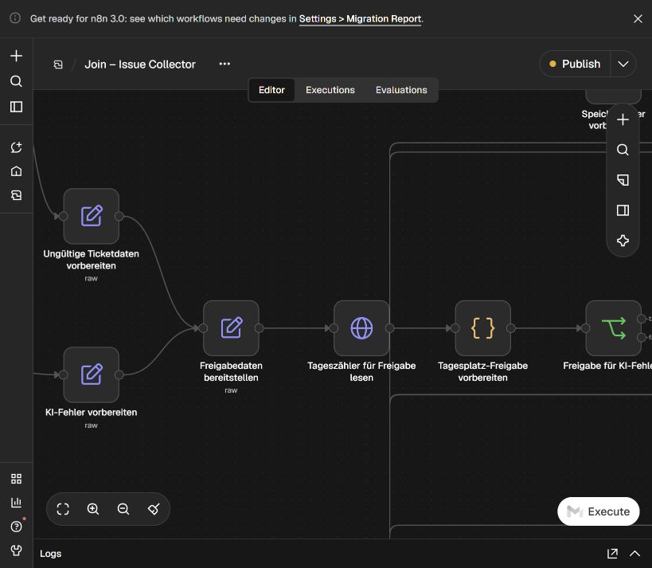
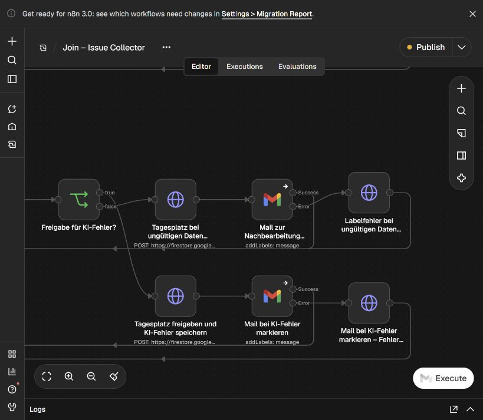
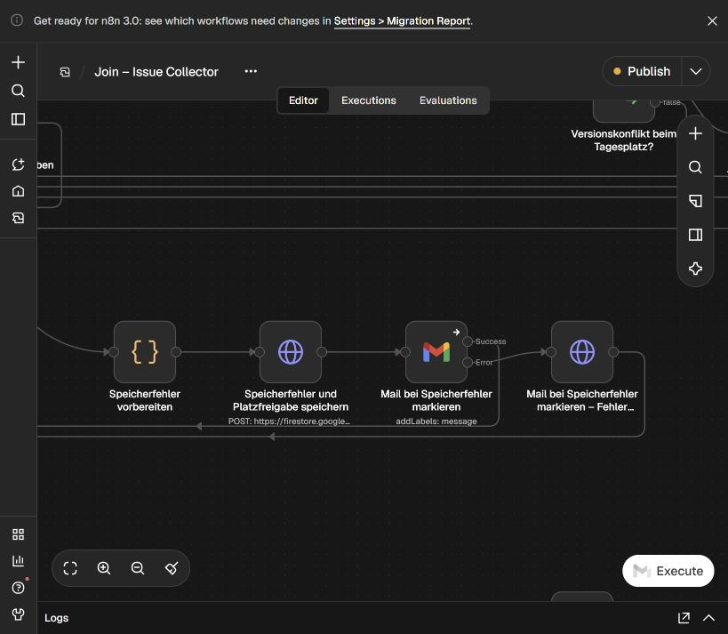
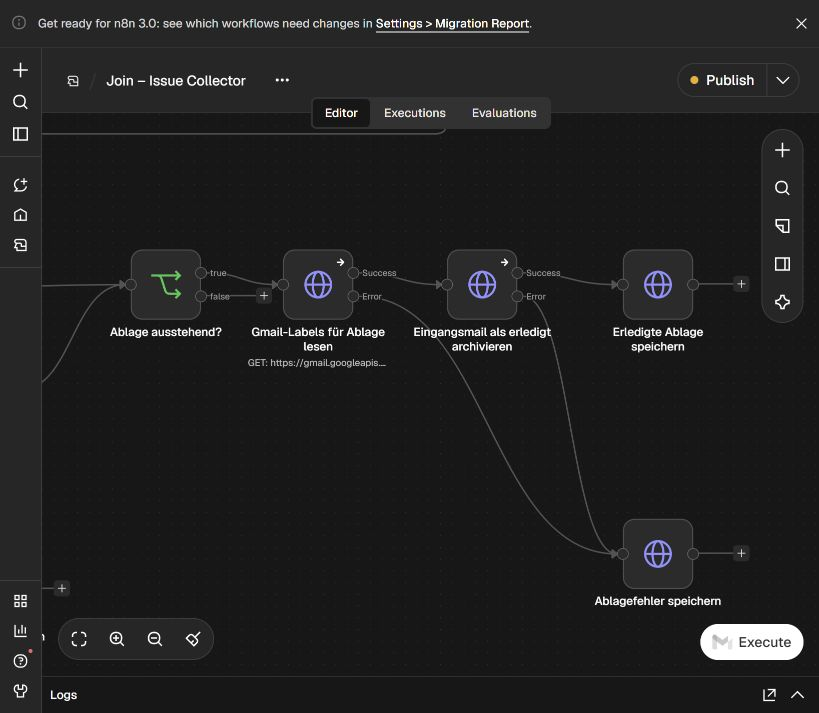
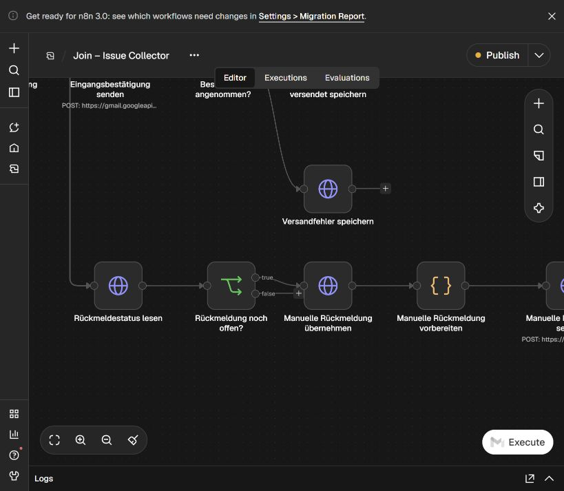

<div align="center">


# Join – Issue Collector

</div>

<div align="center">


</div>

<div align="center">


</div>

<div align="center">

Join is a responsive Kanban project management application for organizing tasks,
tracking progress and collaborating through a shared Firebase data store.
It provides authenticated and guest access to the same board, contacts and task workflow.
The Issue Collector extends Join with a public request form and an n8n pipeline
that turns incoming emails into validated, AI-assisted tickets in Triage.

</div>

## Live Demo

[Open Join – Issue Collector](https://join-n8n-andre-2026.web.app/)

[Project repository](https://github.com/andrewojak1618-debug/Join-with-n8n-implem.)

## Preview



## Table of Contents

- [Features](#features)
- [Issue Collector](#issue-collector)
- [Workflow screenshots](#workflow-screenshots)
- [Tech Stack](#tech-stack)
- [Application Architecture](#application-architecture)
- [Requirements](#requirements)
- [Quickstart](#quickstart)
- [Firebase Setup](#firebase-setup)
- [n8n Setup](#n8n-setup)
- [Ollama Setup](#ollama-setup)
- [Usage](#usage)
- [Demo Walkthrough](#demo-walkthrough)
- [Project Structure](#project-structure)
- [Automated Tests](#automated-tests)
- [Deployment](#deployment)

## Features

| Feature           | Description                                                                                   |
| ----------------- | --------------------------------------------------------------------------------------------- |
| Authentication    | Sign up and sign in with Firebase Authentication.                                             |
| Guest access      | Test the application anonymously while using the shared task and contact data.                |
| Summary           | View task totals, status metrics, deadlines and Email Requests (all tickets with source=email).           |
| Add Task          | Create tasks with a title, description, due date, priority, category, assignees and subtasks. |
| Board             | Organize tasks across Triage, To do, In progress, Await feedback and Done.                            |
| Task editing      | Edit, move and delete existing tasks directly from the board.                                 |
| Subtasks          | Add, edit, remove and complete individual subtasks.                                           |
| Search            | Filter board cards by task title or description.                                              |
| Contacts          | Create, edit and delete contacts and display the signed-in user in the contact list.          |
| Shared data       | Store tasks and contacts centrally in Cloud Firestore.                                        |
| Legal pages       | Switch legal content between English and German while preserving the selected language.       |
| Responsive design | Use the application on desktop, tablet and mobile layouts.                                    |

## Issue Collector

- **Public request flow:** Welcome leads to the stakeholder landing page and
  Your Request. Send request opens an email draft containing recipient, subject
  and the full message. The visitor sends that draft in their email application.
- **Email processing:** n8n reads the collector Gmail inbox, excludes own replies,
  automatic replies and delivery failures before reservation, and extracts readable
  text, including from HTML-only messages.
- **AI classification:** Ollama with `qwen3:4b-instruct` extracts title,
  description, issue type, priority and deadline candidates. Validated results
  map to the board categories User Story and Technical Task. Missing or
  contradictory deadlines remain unset rather than being invented.
- **Triage:** New automatically generated tickets start in Triage. The dialog
  shows the original external creator and an AI indicator. Manual tickets also
  support Triage; internal creators and guests are displayed separately.
- **Global daily quota:** At most ten automatic tickets per day, with the day
  changing at midnight in `Europe/Berlin`. Reservations count toward the quota;
  the landing page displays the current usage and switches to the limit view
  when all ten places are used. Further requests remain available for manual work.
- **Duplicate protection and errors:** A stable mail identity prevents repeated
  processing from creating a second ticket. Failed processing releases its
  reserved place; retries are bounded. Error and limit paths send feedback
  without a ticket ID and label the mail for manual processing (`zu bearbeiten`).
- **Successful processing:** The sender receives a confirmation with the ticket
  ID. The source mail receives `erledigt` and leaves the inbox. Separate delivery
  and filing states allow retrying those steps without creating another ticket.
- **Status notifications:** Saved board status changes produce events with a
  unique ID, ticket ID, old/new status and original creator. n8n uses those events
  to send status messages; guests without an address are skipped.

The hosted frontend does not run n8n or Ollama. Automatic ticket creation and
notifications require the configured workflows and services to be running.
The existing collector export is in `n8n/issue-collector-workflow.json`.
The setup instructions below are documented; all required exports and a clean import test are still being
prepared under C-18; this README is not yet a verified end-to-end install guide.

### Workflow screenshots

The overview shows the complete 89-node Collector editor layout. Expand a stage
below for readable detail views; select an image to open it at its original size.
Connections leaving a detail view continue in the overview or an adjacent stage.
The disconnected diagnostic nodes at the top left are separate from the intake path.
Captured on 2026-11-21; these editor views document the structure, not a test execution.
The separate board-status notification workflow is not shown here.

[](./components/assets/img/collector/collector-overview.jpg)

<details>
<summary>1. Mail intake, reservation and daily quota</summary>

**Gmail intake, automatic-mail filtering and stable mail identity**

[](./components/assets/img/collector/collector-01-mail-intake.jpg)

**Existing mail reservations and retry eligibility**

[](./components/assets/img/collector/collector-02-mail-reservation.jpg)

**Reading and initializing the daily counter**

[](./components/assets/img/collector/collector-03-daily-counter.jpg)

**Checking the quota and reserving one daily place**

[](./components/assets/img/collector/collector-04-quota-reservation.jpg)

**Reading the counter again after a version conflict**

[](./components/assets/img/collector/collector-05-reservation-retry.jpg)

</details>

<details>
<summary>2. AI extraction, validation and ticket storage</summary>

**Ollama extraction with the structured output parser**

[](./components/assets/img/collector/collector-06-ai-extraction.jpg)

**Validating ticket data and saving the ticket with the daily counter**

[](./components/assets/img/collector/collector-07-validation-storage.jpg)

</details>

<details>
<summary>3. Failure handling and reservation release</summary>

**Shared release preparation for AI and validation failures**

[](./components/assets/img/collector/collector-08-release-preparation.jpg)

**Separate failure states, manual-review labels and label-error storage**

[](./components/assets/img/collector/collector-09-processing-errors.jpg)

**Storage failure handling and daily-place release**

[](./components/assets/img/collector/collector-10-storage-error.jpg)

</details>

<details>
<summary>4. Daily-limit response and manual review</summary>

**Preparing and sending the daily-limit response**

[](./components/assets/img/collector/collector-11-limit-response.jpg)

**Recording delivery state and labeling the mail for manual review**

[](./components/assets/img/collector/collector-12-limit-filing.jpg)

</details>

<details>
<summary>5. Confirmation and successful filing</summary>

**Checking delivery state before preparing the confirmation**

[](./components/assets/img/collector/collector-13-confirmation-preparation.jpg)

**Recording confirmation success or a delivery error**

[](./components/assets/img/collector/collector-14-confirmation-result.jpg)

**Applying the completed label, archiving the source mail and recording filing errors**

[](./components/assets/img/collector/collector-15-successful-filing.jpg)

</details>

<details>
<summary>6. Feedback for manual processing</summary>

**Checking and reserving the manual-feedback delivery**

[](./components/assets/img/collector/collector-16-manual-feedback.jpg)

**Sending manual feedback and recording its result**

[](./components/assets/img/collector/collector-17-feedback-result.jpg)

</details>

## Tech Stack

| Technology              | Purpose                                                        |
| ----------------------- | -------------------------------------------------------------- |
| HTML5                   | Semantic page and component structure                          |
| CSS3                    | Responsive layouts, Figma-based styling and interaction states |
| JavaScript ES6+         | Routing, rendering, validation and application logic           |
| Firebase Authentication | Email/password and anonymous guest authentication              |
| Cloud Firestore         | Shared task and contact persistence                            |
| Firebase Hosting        | Public deployment of the application                           |
| n8n and Gmail           | Email intake, processing, confirmations and status notifications |
| Ollama                  | Local AI classification with qwen3:4b-instruct                  |
| Node.js test runner     | Automated tests for central application logic                  |

## Application Architecture

Join uses a multi-page architecture. The HTML files in the project root are
small route entry documents. `main.js` loads the matching page component and,
for protected pages, the shared application layout.

Visible markup is organized according to Atomic Design:

- `atoms` contain the smallest reusable UI elements.
- `molecules` combine atoms into focused controls.
- `organisms` provide larger reusable interface sections.
- `pages` contain route-specific content.
- `templates` provide shared page layouts.

The JavaScript layer separates rendering, validation, stores, Firebase adapters
and feature-specific interactions into focused files.

## Requirements

- Current browser, Git, Node.js LTS and npm; VS Code Live Server for the frontend.
- Windows with Docker Desktop's WSL2/Linux-container backend for the documented
  n8n setup. Start Docker Desktop and wait for its engine before Docker commands.
- Ollama for Windows and sufficient RAM/disk space to load `qwen3:4b-instruct`.
  A compatible GPU improves inference speed; verify a real model response locally.
- Internet access for Firebase, Google OAuth/Gmail, images and model downloads.
- Authorized access to Firebase project `join-n8n-andre-2026`, a registered Web app,
  Firestore `(default)` database, and Google Cloud API/OAuth configuration.
- A dedicated Gmail collector account and a separate sender for end-to-end tests.
  An email application or browser mail handler is required for the request draft.

The hosted frontend needs no local installation. Email automation additionally
needs running n8n/Ollama services and connected credentials. Versions of n8n,
Docker and Ollama must be recorded during the pending fresh-install test; no
tested version matrix is claimed here.

### Installation scope and required inputs

A frontend checkout, email intake and status notifications are separate setup stages.
Prepare the following before starting; a clone alone does not configure cloud accounts.

| Required input | Where it comes from |
| --- | --- |
| Target project and Web app settings | Firebase Console; use a separate project for an independent installation. |
| Firestore `(default)`, rules and indexes | Target project plus the repository configuration; enable sign-in providers in Console. |
| Collector address and sender test account | Two accessible mailboxes; the sender must be able to receive replies. |
| OAuth client and allowed accounts | Google Cloud project with Gmail/Firestore APIs, consent settings and redirect URI. |
| Gmail label IDs | The target collector account; label IDs cannot be copied between accounts. |
| Ollama endpoint and model | Host API reachable from the n8n container, with `qwen3:4b-instruct` installed. |
| Mail handler | A configured browser/OS handler for `mailto:`; Gmail sign-in alone is insufficient. |

Before starting containers, run `docker version` and `docker compose version`.
The Docker server must respond, and Compose must support `docker compose` commands.
Check that ports 5500 (frontend), 5678 (n8n) and 11434 (Ollama) are available,
or identify the existing service using them. Do not start a competing n8n listener.
There is no `package.json` or frontend build step; `npm install` is not required.

### Setup order and remaining installation gaps

1. Clone the repository and record `git rev-parse HEAD` for the version being installed.
2. Configure the target Firebase project and local Web configuration; verify login,
   guest access, and tasks/contacts through Live Server.
3. Install Ollama, pull the model and verify one response before importing the workflow.
4. Start the isolated n8n installation, connect credentials and replace workflow placeholders.
5. Run the intake acceptance checks below with one unique test mail.
6. Install and verify the separate status workflow when its export is available.
7. Configure Hosting separately if a public deployment is required.

The following are still required before claiming a complete, reproducible installation:

- A sanitized export of the status-notification workflow, including its event trigger,
  credential mapping and retry configuration. Only the collector export is tracked today.
- A reviewed Hosting configuration with the public directory and explicit exclusions
  for tests, workflow exports, local data and credentials. `firebase.json` has no Hosting section.
- A recorded fresh-install run with commit, service versions, model identity and results
  for intake, confirmation, filing, duplicate prevention and status delivery after restart.

These gaps do not prevent a local frontend setup. They do prevent treating the
current repository as a complete deployment package. Track completion on C-18.

## Quickstart

```powershell
git clone https://github.com/andrewojak1618-debug/Join-with-n8n-implem..git Join
cd Join
node --version
npm --version
```

Complete Firebase Setup below. Open `index.html` with VS Code **Live Server** and
use `http://127.0.0.1:5500/index.html` (adjust the port if Live Server selects another).
Do not open through `file://`. If Python is installed, an alternative is
`python -m http.server 5500 --bind 127.0.0.1`; Python is not otherwise required.
For automatic emails, continue with n8n Setup and Ollama Setup.

## Firebase Setup

Use the existing project for authorized team work. For an independent test project,
use its own IDs and accounts throughout; do not point isolated tests at live data.

1. In Firebase Console, select the project and verify Authentication has
   **Email/Password** and **Anonymous** sign-in enabled. Add the actual development
   hosts (`localhost` and/or `127.0.0.1`) to Authorized domains without port or scheme.
2. Verify the `(default)` Cloud Firestore database exists. The repository config
   specifies `europe-west3`. Use the checked-in `firestore.rules` and
   `firestore.indexes.json`; do not replace them with open test-mode rules.
3. In Project settings > General, select the registered Web app and copy its
   Firebase SDK configuration into the local template below. These Web settings
   are distinct from n8n's Google OAuth client ID and secret.

```powershell
# Only on a new checkout; preserve an existing local configuration.
Copy-Item components/js/firebase/firebaseConfig.example.js components/js/firebase/firebaseConfig.js
```

Replace the template values for `apiKey`, `authDomain`, `projectId` and `appId`,
retaining `window.joinFirebaseConfig = { ... };`. This project keeps that file
Git-ignored. Never add OAuth secrets, service-account keys or passwords to it.

```powershell
node --check components/js/firebase/firebaseConfig.js
git check-ignore components/js/firebase/firebaseConfig.js
npx -y firebase-tools@latest --version
npx -y firebase-tools@latest login
npx -y firebase-tools@latest use join-n8n-andre-2026
```

An authorized maintainer can deploy the reviewed rules/indexes with
`npx -y firebase-tools@latest deploy --only firestore --project join-n8n-andre-2026`.
This changes the shared backend; it is not required for every frontend checkout.
The committed `firebase.json` does not currently include Hosting configuration;
do not assume a fresh clone can deploy Hosting without the separate C-18 setup.
Use [Firebase Hosting configuration](https://firebase.google.com/docs/hosting/full-config)
to prepare that configuration. Preserve the existing Firestore section and the
multi-page routes; do not add a blanket rewrite of every route to `index.html`.

The landing-page endpoint in `components/js/stakeholder.js` also contains the
project ID. Change it along with `.firebaserc` and the Web config for another
project. Keep the day format `YYYY-MM-DD` and time zone `Europe/Berlin` consistent.
The public daily-counter document must contain only dailyLimit, completedCount
and reservedCount; extra fields cause the checked-in read rule to reject access.
Check login, guest access and loading contacts/tasks before testing automation.
Reference: [Firebase Web setup](https://firebase.google.com/docs/web/setup).

## n8n Setup

### Existing local installation

Start Docker Desktop first, then inspect and start the existing container:

```powershell
docker ps -a --format "table {{.Names}}\t{{.Image}}\t{{.Status}}"
docker start n8n
docker logs --tail 50 n8n
```

Open `http://localhost:5678`. If `n8n` does not exist, use the fresh-install steps.
Do not recreate or delete an existing container/volume to fix an OAuth error.

### Fresh local installation with Docker Compose

Use this only for a new installation, not to migrate the existing `n8n` container.
The running project installation reported n8n `2.45.4` on 2026-11-21. The example
pins that version as a starting point; a fresh import with it is still pending.
Do not silently replace it with `latest`. Record any deliberately chosen version.

From the repository root, create the ignored local configuration directory:

```powershell
New-Item -ItemType Directory -Force n8n/local
```

Save this as `n8n/local/compose.yaml`. It is a minimal local setup for this project,
not the additional Assistant/sandbox stack described in the broader vendor guide.

```yaml
name: join-collector-local
services:
  n8n:
    image: docker.n8n.io/n8nio/n8n:2.45.4
    restart: unless-stopped
    ports:
      - "127.0.0.1:5678:5678"
    environment:
      GENERIC_TIMEZONE: Europe/Berlin
      TZ: Europe/Berlin
      N8N_ENFORCE_SETTINGS_FILE_PERMISSIONS: "true"
    volumes:
      - n8n_data:/home/node/.n8n
volumes:
  n8n_data:
```

With no other service listening on port 5678, run from the repository root:

```powershell
docker compose -f n8n/local/compose.yaml config --quiet
docker compose -f n8n/local/compose.yaml pull
docker compose -f n8n/local/compose.yaml up -d
docker compose -f n8n/local/compose.yaml ps
docker compose -f n8n/local/compose.yaml logs --tail 50 n8n
docker compose -f n8n/local/compose.yaml exec n8n n8n --version
```

Open `http://localhost:5678` and create the local owner account. For this Compose
installation, use `docker compose -f n8n/local/compose.yaml stop` and `up -d` to
stop/start it; `docker start n8n` applies only to the separately named legacy container.
The project-prefixed volume keeps workflow data, credentials and encryption-key state.
Back it up together before upgrades; do not use `down -v`, which removes the data volume.

See [n8n Docker Compose documentation](https://docs.n8n.io/deploy/host-n8n/install-options/install-using-docker-compose.md).
This README example has not yet been used for a complete fresh-install acceptance run.

### Google credentials and workflow import

1. Enable Gmail API and Cloud Firestore API in the relevant Google Cloud project.
   Configure the OAuth consent screen and add the connecting accounts as test
   users when the app is in Testing mode. Create a Web application OAuth client.
2. In n8n create **Gmail OAuth2 API** and **Google Firebase Cloud Firestore OAuth2
   API** credentials. Register the exact redirect URL shown by n8n with the OAuth
   client (local default: `http://localhost:5678/rest/oauth2-credential/callback`).
   Enter the client ID/secret only in n8n. Connect Gmail as the collector account;
   connect Firestore as an account with authorized database read/write access.
3. Grant the requested service scopes and test both credentials. OAuth Firestore
   access needs appropriate Google Cloud IAM permissions; frontend security rules
   are not a substitute. Do not weaken Firestore rules to repair a token error.
4. Import `n8n/issue-collector-workflow.json` through **Import from File** into an
   inactive workflow. Reassign credentials on every Gmail, Firestore HTTP and
   Ollama node, including failure/retry branches; exports contain no usable secrets.
5. Replace every `YOUR_FIREBASE_PROJECT` with the target project ID. Replace
   `collector@example.com` throughout with the collector address, including the
   Gmail search, own-mail filter and identity expressions. Set the same recipient
   in components/js/email-mask.js when using a different collector.
6. Create Gmail labels `zu bearbeiten` and `erledigt`. Replace each
   `YOUR_REVIEW_LABEL_ID` with the actual ID of `zu bearbeiten`, not its display
   name. Check the workflow's name-based lookup for `erledigt` in the same account.
7. Keep Gmail Trigger's full response (`Simplify` off), one-minute polling and
   `in:inbox -from:YOUR_COLLECTOR_ADDRESS` search. Retain the downstream automatic
   mail filter, global limit 10 and `Europe/Berlin` day calculation.
8. Test connections and a uniquely named mail before publishing/activating the
   workflow. Disable duplicate/test listeners on the same inbox. Automatic polling
   only works while n8n is running and the workflow is published/active.

The separate status-notification workflow is not yet supplied in `n8n/`.
Its export, event-input configuration and import verification remain C-18 work;
importing the collector alone does not install status notifications.
For an external OAuth app in Testing mode, refresh tokens with these service scopes
expire after seven days; reconnecting may therefore be required even if Docker is healthy.
See [Google refresh-token expiration](https://developers.google.com/identity/protocols/oauth2#expiration).
Reference: [Google OAuth setup in n8n](https://docs.n8n.io/integrations/builtin/credentials/google/oauth-single-service/).

## Ollama Setup

Install [Ollama for Windows](https://docs.ollama.com/windows), then open a new
PowerShell terminal. The desktop app normally runs the API in the background.

```powershell
ollama --version
ollama pull qwen3:4b-instruct
ollama list
Invoke-RestMethod http://localhost:11434/api/tags
ollama run qwen3:4b-instruct "Antworte kurz mit: Bereit"
```

If the API is not running, start `ollama serve` in a separate terminal and keep
it open. Do not start a second server when port 11434 is already occupied.
In n8n create an Ollama credential with Base URL
`http://host.docker.internal:11434` for Docker Desktop, or
`http://localhost:11434` when n8n runs directly on the same host. Select
`qwen3:4b-instruct` in **Ollama Chat Model** and test the credential plus model node.

If Docker cannot reach the host API, check Ollama's bind address and Windows
firewall. Where needed, configure `OLLAMA_HOST=0.0.0.0:11434` for Ollama and restart
it, restricting firewall access to the local Docker environment. This exposes a
listener beyond loopback; do not expose the unauthenticated API to the internet.
See [Ollama with n8n](https://docs.ollama.com/integrations/n8n) and
[Ollama server configuration](https://docs.ollama.com/faq).

### Setup checks and recovery

| Symptom | Check |
| --- | --- |
| Docker named-pipe/WSL error | Start/restart Docker Desktop, wait for engine, then `docker start n8n`. |
| Google credential needs reconnecting | Reconnect that credential and grant its scopes; check consent/test-user settings. |
| Firestore permission denied | Check account, project, IAM for n8n, and auth/rules for the frontend separately. |
| Ollama unavailable | Check `/api/tags`, model tag and Docker-versus-host Base URL. |
| No automatic Gmail run | Check published/active workflow, collector account, inbox search and polling. |

After setup, send one unique test mail and verify one Triage ticket, one matching
confirmation, `erledigt` without INBOX, and the matching daily counter. Repeat
processing to check duplicate prevention. Test status notifications only after
their separate workflow is installed. Record the Git commit, n8n/Docker/Compose/Ollama versions, the model ID from
`ollama list`, and results on C-18. Restart n8n, then repeat a new-mail test to
verify persistent credentials and automatic polling. Keep workflow execution IDs
and test ticket IDs with the result; never record tokens or passwords.
These are acceptance steps, not a claim that a clean import has already passed.


## Usage

- From Welcome, choose Create request for the public email request flow.
- Choose Member log in to sign in, register or use the guest login.
- Review task totals and the next deadline on the Summary page.
- Create a task through Add Task or from a Board column.
- Assign contacts, choose a priority and add subtasks.
- Move task cards between the five workflow columns using drag and drop or the mobile status menu.
- Open a task card to edit its data or complete individual subtasks.
- Search the board by task title or description.
- Manage contacts from the Contacts page.

Guest and authenticated users work with the same shared Firestore data set.

## Demo Walkthrough

This is a presentation guide, not a new live-test result. Use a unique subject
such as `DEMO-YYYYMMDD-HHMM - Board does not load` to identify one complete run.

### Before the demonstration

- Open the hosted Join app, the sender's mailbox, the collector inbox and n8n
  Executions. Use a separate sender account with an address you can read.
- Confirm Firebase is reachable, Ollama responds, and the regular collector and
  separate status-notification workflow are active. Only one intake workflow
  should watch this inbox. A fresh import still needs the missing status export.
- Check today's Europe/Berlin quota: fewer than ten completed plus reserved
  places are needed for the automatic success path. Record its starting value.
  Do not reset the shared production counter for a demonstration.

### From request to confirmation

1. Open Welcome and select **Create request**. On the stakeholder landing page,
   show the quota and select **Create request** to open **Your Request**.
2. Enter your name, the actual sender address, the unique subject and a clear
   message, for example: `When I open the Board, the task list stays empty.
   Please investigate. There is no deadline.` Keep the example free of private data.
3. Select **Send request**. This only opens a draft; it does not submit a ticket.
   Verify recipient `ai.viralreelcreator@gmail.com`, subject and complete message,
   including the appended name and email. For another installation, use its
   configured collector. Send the draft once from the matching sender account.
   If Outlook opens instead of Gmail, configure the browser/OS mail handler;
   being signed into Gmail alone does not select it as the mailto handler.
4. In n8n Executions, find the run for that mail. Allow the one-minute polling
   interval plus model processing time. Follow filtering, mail/day reservation,
   Ollama, validation, ticket storage, confirmation and filing. If processing
   fails, inspect that execution rather than sending duplicate demonstration mail.
5. Use **Member log in** to enter Join and open Board. Find exactly one matching
   ticket under **Triage**. Open it and record its ticket ID; check title,
   description, category, priority, external creator and AI indicator. With this
   example, no deadline should be invented. AI wording may vary.
6. In the sender's inbox, verify exactly one confirmation with that same ticket
   ID. In the collector, verify the source mail has **erledigt** and is no longer
   in Inbox. Compare the quota with its starting value: one completed place added
   and no outstanding reservation for this mail, assuming no concurrent requests.

### From board change to status email

7. Move that ticket once from **Triage** to **To do** using desktop drag and drop
   or the mobile status menu. Wait for the save to succeed, then reload the Board
   to confirm the new status persists; do not move it again merely to refresh.
8. In the status workflow's execution, match the event ID and ticket ID, old/new
   status and original creator's address. In that creator's inbox, verify exactly
   one status message with the same ticket ID and the understandable new status.
   This is a second type of message, separate from the creation confirmation.
   A guest ticket without an email address intentionally receives no status mail.
9. Record subject, execution/event references, ticket ID, quota before/after and
   message counts on C-18. Keep credentials and private mail content out of Git.
   Do not delete shared records as part of the presentation without agreement.

### Optional error and limit demonstrations

Use isolated test reservations/counters for fault injection. At ten of ten,
show the manual-processing explanation: no automatic ticket, one limit reply
without a ticket ID, and **zu bearbeiten** while the mail remains in Inbox.
For a controlled AI/validation/storage failure, verify feedback without a ticket
ID, **zu bearbeiten**, no ticket/success confirmation and one release of the
reserved place even on retry. Do not disable production services to stage this.
If the status workflow is unavailable, mark the final stage as unverified rather
than presenting a creation confirmation as proof of a status notification.

## Project Structure

- `components/assets/`: fonts, images and icons.
- `components/css/` and `components/html/`: shared controls, dialogs and pages.
- `components/js/`: page logic, stores, Firebase adapters and validation.
- `n8n/`: collector workflow export; `n8n/local/` is ignored for local material.
- `tests/`: automated checks; `tests/local/` is ignored.
- Root HTML files: Welcome, login, signup, stakeholder, request form and board pages.
- `main.js` / `base.css`: shared entry logic and base styling.
- `firebase.json`, `.firebaserc`, `firestore.rules`, `firestore.indexes.json`: backend configuration.

## Automated Tests

The repository contains automated tests for important logic paths, including:

- task storage and date normalization
- summary metrics and upcoming deadlines
- board search
- board edit validation
- assignee normalization
- contact names and email validation
- privacy-policy consent
- legal-page language defaults, persistence and synchronization
- asynchronous error handling

Run the complete test suite from the project root:

```bash
node --test
```

## Deployment

The application is deployed with Firebase Hosting:

```text
https://join-n8n-andre-2026.web.app/
```

Before a deployment, verify the working tree, run the automated tests and test
the main user stories on desktop and mobile resolutions.
